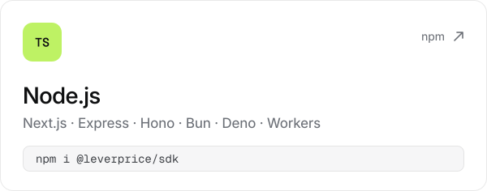
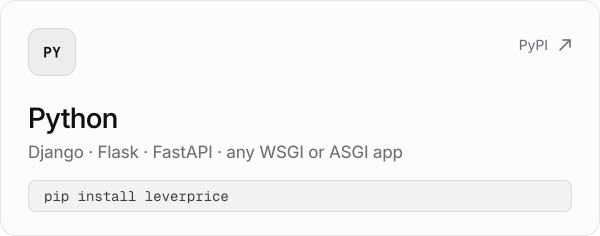
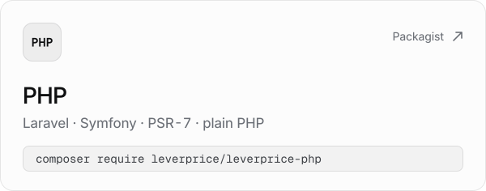
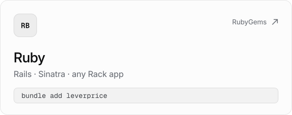
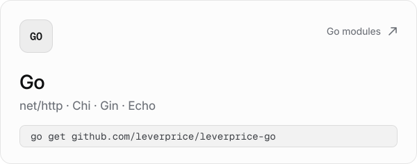
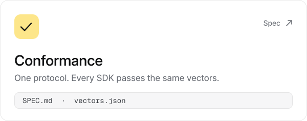

<a href="https://leverprice.com">
  <picture>
    <source media="(prefers-color-scheme: dark)" srcset="https://raw.githubusercontent.com/leverprice/.github/main/assets/banner-dark.svg">
    
  </picture>
</a>

<br>

Leverprice runs price experiments on your own server. Your code asks for a price, charges it through your own Stripe, Polar, Lemon Squeezy or Dodo Payments account, and reports the purchase. Leverprice compares revenue per visitor across prices and shifts traffic to the one that earns the most.

**[Website](https://leverprice.com)** &nbsp;·&nbsp; **[Documentation](https://leverprice.com/docs)** &nbsp;·&nbsp; **[Security](https://github.com/leverprice/.github/blob/main/SECURITY.md)**

<br>

### Server SDKs

<a href="https://github.com/leverprice/leverprice-node"><picture><source media="(prefers-color-scheme: dark)" srcset="https://raw.githubusercontent.com/leverprice/.github/main/assets/sdk/node-dark.svg"></picture></a>
<a href="https://github.com/leverprice/leverprice-python"><picture><source media="(prefers-color-scheme: dark)" srcset="https://raw.githubusercontent.com/leverprice/.github/main/assets/sdk/python-dark.svg"></picture></a>
<a href="https://github.com/leverprice/leverprice-php"><picture><source media="(prefers-color-scheme: dark)" srcset="https://raw.githubusercontent.com/leverprice/.github/main/assets/sdk/php-dark.svg"></picture></a>
<a href="https://github.com/leverprice/leverprice-ruby"><picture><source media="(prefers-color-scheme: dark)" srcset="https://raw.githubusercontent.com/leverprice/.github/main/assets/sdk/ruby-dark.svg"></picture></a>
<a href="https://github.com/leverprice/leverprice-go"><picture><source media="(prefers-color-scheme: dark)" srcset="https://raw.githubusercontent.com/leverprice/.github/main/assets/sdk/go-dark.svg"></picture></a>
<a href="https://github.com/leverprice/leverprice-node/tree/main/conformance"><picture><source media="(prefers-color-scheme: dark)" srcset="https://raw.githubusercontent.com/leverprice/.github/main/assets/sdk/conformance-dark.svg"></picture></a>

<br>

### Three calls

```ts
import { Leverprice } from "@leverprice/sdk";

const leverprice = new Leverprice({
  secretKey: process.env.LEVERPRICE_SECRET_KEY,
  products: { pro: { currency: "usd", fallbackPrice: 1900, minPrice: 1500, maxPrice: 3900 } },
});

// 1. Where the price is shown
const quote = await leverprice.getPrice("pro", { request });

// 2. At checkout, with your own provider keys
await stripe.checkout.sessions.create({
  mode: "payment",
  line_items: [{ quantity: 1, price_data: { currency: quote.currency, unit_amount: quote.price, product_data: { name: "Pro" } } }],
  metadata: quote.metadata,
  success_url,
  cancel_url,
});

// 3. When the payment lands
await leverprice.trackPurchase({ provider: "stripe", orderId, amount, currency, metadata });
```

<br>

### Built for the payment path

- **Fails safe.** If Leverprice is slow, down or misconfigured, you get your own fallback price within 500 ms. Pricing never throws for that.
- **Your payments stay yours.** Leverprice never sees card data or provider API keys.
- **Signed and bounded.** Every config is signature-checked, and every price is checked against the minimum and maximum you set in code.
- **Sticky.** A visitor keeps the same price across visits, and search engines always see your standard price.
- **Private.** Visitor and user ids are hashed on your server before anything leaves it.

<br>

<sub>The SDKs are MIT-licensed. Found a vulnerability? Write to <a href="mailto:security@leverprice.com">security@leverprice.com</a>.</sub>
